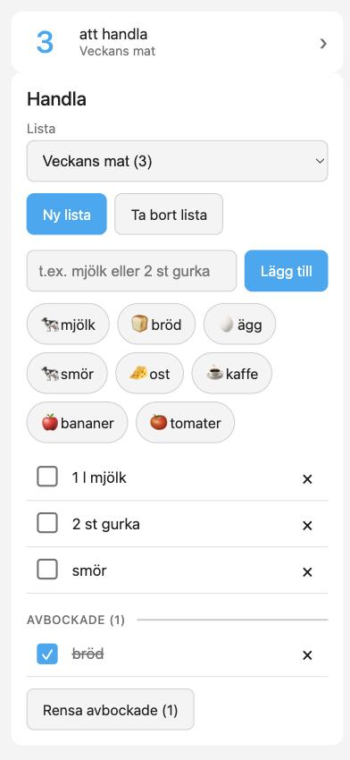
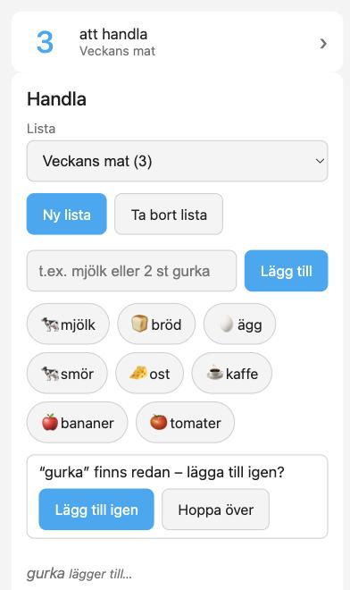

# Handla

Shared shopping lists for Home Assistant, on top of your ICA lists. Everyone in the household sees the same list, adds items in a second, and gets a notification when someone else adds something.

[Svenska](README.sv.md)

[](https://github.com/per-lennartsson/ha-ica-dashboard/actions/workflows/ci.yaml)
[](https://github.com/per-lennartsson/ha-ica-dashboard/releases)
[](LICENSE)

**Live:** download the latest build from [GitHub Releases](https://github.com/per-lennartsson/ha-ica-dashboard/releases) (installable through HACS, see Installation).

<p>
  
  
</p>

*Screenshots are a preview with sample data.*

## What it does

- **Shared ICA lists:** choose, create and delete lists. A new list gets a name like "Att handla 14 oktober".
- **Fast adding:** type an item and press Enter; the field stays ready for the next one. Quantities work: `2 st gurka`, `1,5 l mjölk`, `500 g nötfärs`.
- **Quick-add buttons:** with icons, based on what you actually add most. Remove, merge ("Tomat" + "Tomater") or pin your own from the *Manage* button.
- **Duplicate check:** "finns redan – lägga till igen?" before adding something that is already on the list.
- **Tick off, remove, clear ticked:** changes show up live on every device, also when made in the ICA app.
- **Categories:** the list is grouped by store department (fruit & vegetables, dairy, …) in the order you walk through the shop. Move an item to another department with the tag button; ICA remembers the choice. With AI on, one button sorts the items ICA could not place. See [docs/usage.md](docs/usage.md).
- **Notifications:** a push to the people you choose when someone *else* adds items (several quick adds become one message).
- **Phone shortcut:** a small card (or a badge) with the number of items left, that opens the shopping view.
- **AI (optional, off by default):** paste a recipe or a meal plan and review the suggested items before adding them, with any AI provider Home Assistant supports. See [docs/ai.md](docs/ai.md).
- **Swedish and English.**

## Requirements

- Home Assistant 2026.9 or newer, with [HACS](https://hacs.xyz/).
- An ICA account, connected through [ha-ica-todo](https://github.com/per-lennartsson/ha-ica-todo) **v0.12.0 or newer** (needed for categories) (a maintained fork of the ICA integration). Handla checks this and tells you if it is missing.

## Installation

1. **Install ha-ica-todo** and set it up with your ICA account:
   HACS → ⋮ → *Custom repositories* → add `https://github.com/per-lennartsson/ha-ica-todo` as type *Integration* → download → restart Home Assistant → *Settings → Devices & services → Add integration → ICA*.
2. **Install Handla** the same way: add `https://github.com/per-lennartsson/ha-ica-dashboard` as a custom repository (type *Integration*), download the latest release and restart Home Assistant.
3. *Settings → Devices & services → Add integration → **Handla**.* That is all; no dashboard resource has to be added by hand.
4. *(Optional)* **Notifications:** *Devices & services → Handla → Configure*. Choose who is told, and which `mobile_app_...` service reaches their phone. The same menu lets you fix the language of the notifications (Swedish or English) if Home Assistant itself uses another one.

5. *(Optional)* **AI:** *Devices & services → Handla → Configure → AI (optional)*. Needs an *AI Task* entity from an AI provider in Home Assistant. Off until you turn it on; see [docs/ai.md](docs/ai.md).

## Dashboard

Add the card to a dashboard (for example a view with the path `handla`):

```yaml
type: custom:handla-card
# language: sv   # optional: show the card in sv or en whatever language Home Assistant uses
```

For the phone dashboard, a small shortcut that shows how many items are left and opens that view when tapped:

```yaml
type: custom:handla-shortcut
navigation_path: /lovelace/handla
```

Everything about the cards, the badge option, entities, services and events is in [docs/usage.md](docs/usage.md).

## Limitations

- Creating or deleting a list makes the ICA integration reload, which takes a few seconds. The card shows progress and locks itself meanwhile, so nobody taps twice.
- The quick-add buttons are based on items added **through Handla**. Items added directly in the ICA app are not counted (they do show up in the list).
- Notifications are sent for items added through Handla, not for items added in the ICA app, and tapping a notification does not open the card yet.
- With AI on, the pasted text goes to the AI provider you chose. The provider's token limit can cut long lists short; see [docs/ai.md](docs/ai.md).
- ICA ignores an empty unit, so renaming an item cannot remove its unit.
- Icons are Material Design Icons picked by a small list of Swedish grocery words; unknown items get a cart.

## Troubleshooting

- **The card says "Handla körs inte":** check that ha-ica-todo (v0.12.0+) is installed and loaded, and look under *Settings → System → Repairs*.
- **The card does not show up:** restart Home Assistant after installing, then reload the page (in the phone app: *Settings → Companion app → Troubleshooting → Reset frontend cache*).
- **Something looks wrong after an update:** hard-refresh the browser. The card file is versioned, but browsers can be stubborn.

## Development

See [docs/dev.md](docs/dev.md) (tests need no running Home Assistant; Node tooling runs in Docker) and [plan.md](plan.md) for status.

## Architecture

The `handla` integration (Python) owns the logic: lists, duplicate rules, usage statistics, notifications and the optional AI module. A thin card (TypeScript/Lit) only draws the UI and calls the integration's services. All calls to ICA go through the `ha-ica-todo` services and `todo` entities, and every service call is kept in a separate I/O layer so the domain logic is plain Python that tests without Home Assistant.

```
custom_components/handla/   # the integration: coordinator, services, entities, notifications, AI
  domain/                   # pure logic (parsing, duplicates, naming), no Home Assistant imports
  *_api.py                  # the only modules that call todo.*, ica.*, ai_task.* and notify.*
frontend/                   # the Lit card and its tests (built into handla.zip by the release workflow)
tests/                      # pytest with mocked ICA and AI
docs/                       # usage, AI, development and release guides
.github/workflows/          # CI (lint, types, tests, hassfest, HACS) and the release pipeline
```

## Tech stack

| Component | Choice | Why |
|---|---|---|
| Integration | Python 3.14, Home Assistant custom integration | Config flow, services, entities and events are what Home Assistant users expect |
| Card | TypeScript, Lit, Vite | Small bundle, the same web components approach as Home Assistant's own frontend |
| ICA access | `ha-ica-todo` | Already handles ICA login and lists; Handla never touches ICA credentials |
| AI (optional) | Home Assistant `ai_task` | Works with any provider, none is assumed installed |
| Tests | pytest + `pytest-homeassistant-custom-component`, Vitest + jsdom | Runs without a real Home Assistant or ICA account |
| Lint and types | Ruff, mypy, ESLint, Prettier, `tsc` | Enforced in CI |
| CI/CD | GitHub Actions, HACS | A pushed tag runs the tests and publishes `handla.zip` ([docs/release.md](docs/release.md)) |

## License

[MIT](LICENSE)

## Built with

Claude Code (agentic development) as part of the course Next-Generation Software Development with AI.
