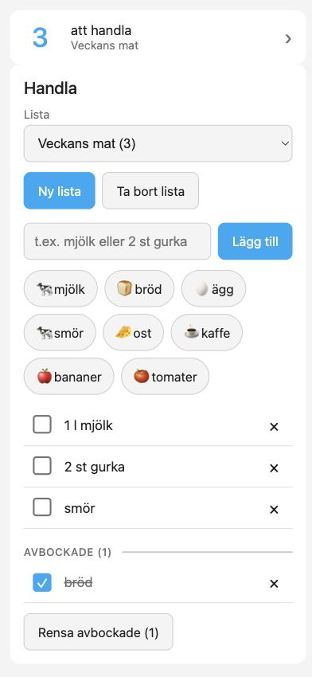
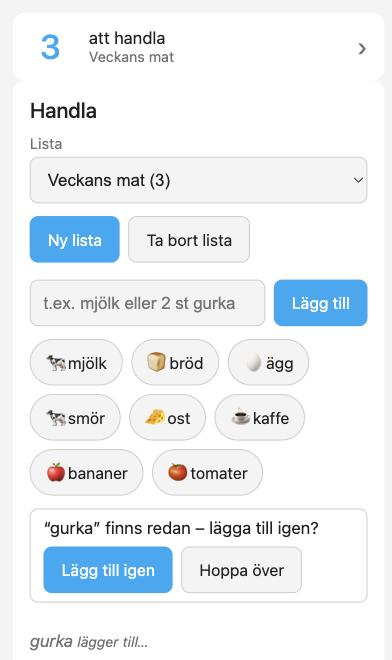

# Handla

Gemensamma inköpslistor i Home Assistant, ovanpå dina ICA-listor. Alla i hushållet ser samma lista, lägger till varor på ett ögonblick och får en avisering när någon annan lägger till något.

[English](README.md)

<p>
  
  
</p>

*Skärmbilderna är en förhandsvisning med exempeldata.*

## Vad den gör

- **Gemensamma ICA-listor:** välj, skapa och ta bort listor. En ny lista får ett namn som "Att handla 14 oktober".
- **Snabb inmatning:** skriv en vara och tryck Enter; fältet är redo för nästa. Mängder fungerar: `2 st gurka`, `1,5 l mjölk`, `500 g nötfärs`.
- **Snabbknappar:** med ikoner, baserade på det ni faktiskt lägger till oftast.
- **Dubblettkontroll:** "finns redan – lägga till igen?" innan något som redan står på listan läggs till.
- **Bocka av, ta bort, rensa avbockade:** ändringar syns direkt på alla enheter, även när de görs i ICA-appen.
- **Aviseringar:** en push till de du väljer när någon *annan* lägger till varor (flera snabba tillägg blir ett meddelande).
- **Genväg på telefonen:** ett litet kort (eller en bricka) med antalet varor kvar, som öppnar inköpsvyn.
- **Svenska och engelska.**

## Krav

- Home Assistant 2026.9 eller nyare, med [HACS](https://hacs.xyz/).
- Ett ICA-konto, anslutet via [ha-ica-todo](https://github.com/per-lennartsson/ha-ica-todo) **v0.10.0 eller nyare** (en underhållen fork av ICA-integrationen). Handla kontrollerar detta och säger till om det saknas.

## Installation

1. **Installera ha-ica-todo** och ställ in den med ditt ICA-konto:
   HACS → ⋮ → *Anpassade databaser* (*Custom repositories*) → lägg till `https://github.com/per-lennartsson/ha-ica-todo` som typ *Integration* → ladda ner → starta om Home Assistant → *Inställningar → Enheter och tjänster → Lägg till integration → ICA*.
2. **Installera Handla** på samma sätt: lägg till `https://github.com/per-lennartsson/ha-ica-dashboard` som anpassad databas (typ *Integration*), ladda ner den senaste utgåvan och starta om Home Assistant.
3. *Inställningar → Enheter och tjänster → Lägg till integration → **Handla**.* Det är allt; ingen dashboard-resurs behöver läggas till för hand.
4. *(Valfritt)* **Aviseringar:** *Enheter och tjänster → Handla → Konfigurera*. Välj vem som ska få veta, och vilken `mobile_app_...`-tjänst som når deras telefon.

## Dashboard

Lägg kortet på en dashboard (till exempel en vy med sökvägen `handla`):

```yaml
type: custom:handla-card
```

För telefonens dashboard, en liten genväg som visar hur många varor som är kvar och öppnar den vyn när man trycker:

```yaml
type: custom:handla-shortcut
navigation_path: /lovelace/handla
```

Allt om korten, bricka-alternativet, entiteter, tjänster och händelser finns i [docs/usage.md](docs/usage.md) (på engelska).

## Bra att veta

- När en lista skapas eller tas bort laddar ICA-integrationen om sig, vilket tar några sekunder. Kortet visar förloppet och låser sig under tiden, så ingen trycker två gånger.
- Snabbknapparna bygger på varor som lagts till **via Handla**. Varor som läggs till direkt i ICA-appen räknas inte (men de syns i listan).
- Aviseringar skickas för varor som läggs till via Handla, inte för varor som läggs till i ICA-appen, och ett tryck på en avisering öppnar inte kortet än.
- ICA ignorerar en tom enhet, så att byta namn på en vara kan inte ta bort dess enhet.
- Ikonerna är Material Design Icons som väljs med en liten lista över svenska matvaror; okända varor får en kundvagn.

## Felsökning

- **Kortet säger "Handla körs inte":** kontrollera att ha-ica-todo (v0.10.0+) är installerad och laddad, och titta under *Inställningar → System → Reparationer*.
- **Kortet syns inte:** starta om Home Assistant efter installationen och ladda sedan om sidan (i telefonappen: *Inställningar → Companion-appen → Felsökning → Återställ frontend-cache*).
- **Något ser fel ut efter en uppdatering:** uppdatera webbläsaren med tvingad omladdning. Kortets fil är versionsmärkt, men webbläsare kan vara envisa.

## Utveckling

Se [docs/dev.md](docs/dev.md) (tester behöver ingen körande Home Assistant; Node-verktygen körs i Docker) och [plan.md](plan.md) för status.
